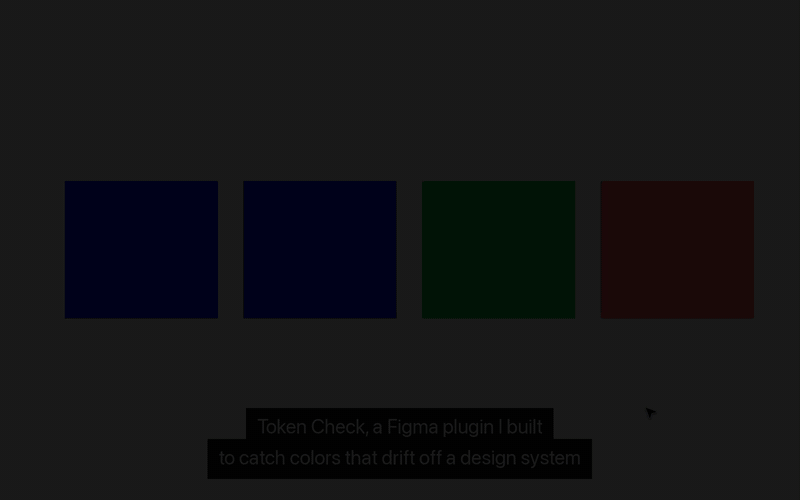

# Token Check

A Figma plugin that finds colors that aren't tied to your design system, and fixes them.

It scans the page, or just your selection, for solid fills and strokes that use a raw color instead of a color variable (token) or a color style. It lists each one with its nearest token, measured by how close the colors look (OKLab), not by raw RGB numbers. Click a row to jump to the layer. Press **Snap** to bind a close color to its token, or **Bind exact matches** to fix every color that already matches a token exactly, with no visual change. Colors with no close token are flagged but never snapped, because that would change the design. Tune the cutoff with `CLOSE_ENOUGH` at the top of `code.ts`.

## Why

At OrderSync I caught design-system drift in code: a Playwright script screenshots every page in light and dark mode and flags any color outside the system. Token Check moves that same check into Figma, so designers catch drift before handoff instead of after it ships.

## Run it

1. `npm install`
2. `npm run watch` (compiles `code.ts` to `code.js` on every save)
3. In the **Figma desktop app**: Plugins → Development → Import plugin from manifest… → pick `manifest.json`
4. Run it from Plugins → Development → Token Check

## How it works

- `code.ts` runs in Figma's plugin sandbox. It walks the nodes, reads `fills` and `strokes`, and skips any paint that's bound to a variable (`paint.boundVariables.color`) or comes from a color style. It finds the nearest local color variable with `resolveForConsumer`, so light and dark modes resolve correctly. Then it binds the variable with `figma.variables.setBoundVariableForPaint`.
- `ui.html` is the panel. It talks to `code.ts` with `postMessage` and uses Figma's theme colors, so it matches light and dark mode.
- Colors inside instances are skipped, because they belong to the main component.
- Hidden layers are skipped. Big pages are scanned in batches with a progress count, so Figma stays responsive, and each token is resolved once per variable mode instead of once per layer.

## Test it

`npm test` builds the plugin and runs `code.js` against a fake Figma API, so the scan, snap and edge cases (deleted layers, broken tokens, empty selection, a 2,000-layer page) can be checked without opening Figma.

## Next

- Library tokens, not just local variables (`figma.teamLibrary`)
- Text layers with more than one color, gradients and effects
- A Figma REST API version that runs the same check in CI on a whole file
